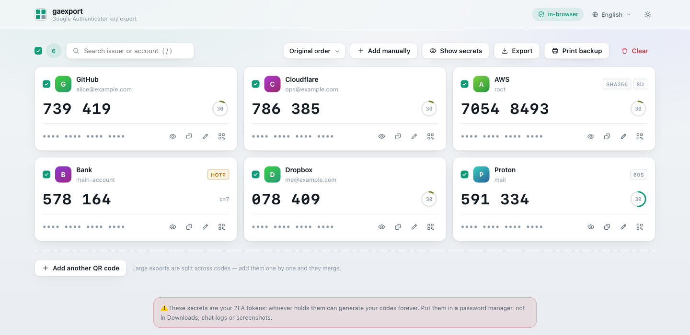

# gaexport

Export the OTP secrets out of Google Authenticator — and put them back.

Google Authenticator can move your accounts to a new phone, but it will not tell
you what they *are*: "Transfer accounts → Export accounts" produces a QR code
holding an `otpauth-migration://offline?data=…` URI, whose payload is a
base64-encoded protobuf blob. `gaexport` reads that blob and gives you back
plain, portable keys — as `otpauth://` URIs, JSON, CSV, an import file for
another authenticator, or one QR code per account.

It also goes the other way: hand it a pile of `otpauth://` URIs and it will pack
them into Google Authenticator's own export QR codes so you can scan them into a
fresh install.



Three ways to use it, same Rust core underneath:

| | | |
|---|---|---|
| **Hosted page** | the link in this repo’s About box | Static site. The decoder is WebAssembly running in your browser — nothing is uploaded, because there is no backend. |
| **Local browser UI** | `gaexport serve` | Loopback-only server with the same UI, for when you would rather not use a hosted page at all. |
| **CLI** | `gaexport decode export.png` | Scriptable, pipeable, offline. |

---

## Install

```sh
# from source (needs a Rust toolchain)
cargo install --path .

# or grab a binary from the releases page, or build a slim CLI-only version:
cargo install --path . --no-default-features --features cli,qr-decode
```

## Quick start

1. On your phone: **Google Authenticator → avatar (top right) → Transfer accounts
   → Export accounts**, confirm with fingerprint/face, pick the accounts.
2. Screenshot the QR code. Many accounts? Google splits the export across
   several codes — swipe and screenshot each one.
3. On your computer:

```sh
gaexport ~/Desktop/export*.png
```

```
decoded 6 keys (5 TOTP, 1 HOTP) from 2 sources
otpauth://totp/ACME%20Co:alice@example.com?secret=JBSWY3DPEHPK3PXP&issuer=ACME%20Co
otpauth://totp/GitHub:cluas?secret=GEZDGNBVGY3TQOJQ…&issuer=GitHub&algorithm=SHA256&digits=8
…
```

No screenshot handy? The camera works too — `gaexport serve`, then *Scan with
camera* and point it at the phone. Or paste the URI directly:

```sh
gaexport -u 'otpauth-migration://offline?data=CjEKCkhlbGxv…'
```

## Commands

```
gaexport [PATH|URI]...        decode (the default when no subcommand is given)
gaexport decode …             decode export QR codes / URIs into keys
gaexport codes …              live OTP codes in the terminal
gaexport qr …                 one QR code per account, for another app
gaexport encode …             pack keys back into Google Authenticator export codes
gaexport serve                browser UI on localhost
gaexport completions <shell>  shell completion script
```

Input can be a QR image, a directory of images, a text file, a `-` for stdin, or
a URI — mixed freely. Text input is scanned for URIs anywhere inside it, so
pasting a log line or a JSON blob works.

```sh
# a readable table, with live codes
gaexport decode ~/Desktop/export.png --format table --codes

# watch codes tick over (like the app, but in your terminal)
gaexport codes export.png --watch

# hand off to another authenticator
gaexport decode export.png --format aegis -o aegis-import.json
gaexport qr export.png --out ./qrcodes          # or --image-format svg / ansi

# safe to paste in a bug report: secrets replaced with <redacted>
gaexport decode export.png --format table --redact

# move to a new phone: re-pack into Google Authenticator export codes
gaexport encode -i keys.txt --out ./ga-import --per-batch 10

# pipelines
pbpaste | gaexport decode --format json | jq -r '.entries[].issuer'
gaexport decode export.png | grep -i github
```

### Output formats

| `--format` | What it is |
|---|---|
| `uri` (default) | One `otpauth://` URI per line — accepted by Aegis, 2FAS, Bitwarden, 1Password, KeePassXC, Ente Auth, … |
| `json` / `json-pretty` | `{ generator, count, entries: [{ issuer, name, type, secret, algorithm, digits, period, counter, uri }] }` |
| `csv` | Same columns, for a spreadsheet or a password-manager import |
| `table` | Aligned, human-readable; add `--codes` for live codes and a TTL column |
| `aegis` | Aegis Authenticator's plain-JSON import file |

`gaexport qr` writes PNG (default), SVG, or terminal ANSI; `gaexport encode`
writes Google Authenticator's export codes.

## The browser UI

```sh
gaexport serve
#  gaexport  http://127.0.0.1:8765/
#    · QR decoding runs in this process; OTP codes are computed in your browser
#    · nothing is stored: no database, no files, no request logging
#    · exits automatically after 900s idle
```

Drop or paste a screenshot, take a photo, or scan with the camera — the camera
stays open across several codes because large exports are split. You get a card
per account with a live code and countdown, search, reveal-on-demand secrets,
per-account QR codes, downloads in every format above, and a printable backup
sheet.

You can also fix things up before exporting: **edit** any account (issuer,
account name, secret, TOTP/HOTP, algorithm, digits, period, counter), **add** one
by hand, **delete** one, and **tick only the accounts you want** — every export,
including the Google Authenticator QR codes, acts on the selection. Edits are
validated by the same Rust core that did the decoding: the form builds a
candidate `otpauth://` URI, the core normalises it, and the card then shows
exactly what an export will contain.

The UI ships in 10 languages, follows your browser's language, and its theme
setting cycles system → light → dark.

`serve` binds to loopback and refuses anything else unless you pass
`--allow-remote`, in which case a token is required. Use an SSH tunnel instead:
`ssh -L 8765:localhost:8765 yourhost`.

## Hosting the online version

The hosted build is a **static site**: `scripts/build-web.sh` compiles the same
Rust decoder to WebAssembly and drops it next to the UI, so the page decodes QR
codes, computes codes and renders QR codes entirely in the visitor's browser. A
server never sees a secret — which is the only way a hosted 2FA-export tool can
be trustworthy.

```sh
./scripts/build-web.sh dist            # needs wasm-pack
python3 -m http.server -d dist 8080    # preview
```

**GitHub Pages** — enable *Settings → Pages → Source: GitHub Actions*; the
`pages` workflow then builds and deploys on every push to `main`, and your site
is at `https://<you>.github.io/gaexport`.

Want your own domain? No domain is baked into this repository. Set a repository
variable `PAGES_CNAME` (*Settings → Secrets and variables → Actions →
Variables*) to e.g. `2fa.example.com`, add the matching DNS record — `CNAME` to
`<you>.github.io` for a subdomain — and set the same domain under *Settings →
Pages → Custom domain*. Locally, `PAGES_CNAME=… ./scripts/build-web.sh` or a
git-ignored `web/CNAME` does the same thing.

**Your own cluster** — `Dockerfile.web` builds an nginx image serving the same
`dist` (with a CSP that blocks outbound connections), and `deploy/k8s.yaml` has a
Deployment/Service/Ingress ready for k3s with cert-manager:

```sh
docker build -f Dockerfile.web -t ghcr.io/cluas/gaexport-web:0.1.0 .
kubectl apply -f deploy/k8s.yaml     # edit the image and host first
```

The plain `Dockerfile` runs `gaexport serve` instead. That mode uploads the
export to the container, so keep it for yourself — private host, TLS, token —
and prefer the static build for anything public.

## Security notes

The whole point of this tool is to hand you material that is *equivalent to your
2FA tokens*. Anyone who gets a secret can generate your codes indefinitely, and
rotating means re-enrolling every account by hand. So:

- **Nothing leaves your machine.** The binary makes no outbound network requests
  at all; the hosted page makes none either (its CSP forbids them).
- **Nothing is stored.** No database, no cache, no request logging. `serve`
  exits on its own after an idle period.
- **Secrets are wiped from memory** when entries are dropped (`Zeroizing`).
- **Files are created `0600`** and warned about on stderr.
- **`--redact`** replaces every secret in every format, so output is safe to
  paste into an issue. Error messages redact `secret=` values too.
- **`serve` is loopback-only** by default, sends `no-store` and a strict CSP,
  and requires a token for any non-loopback bind.
- **Watch the side channels** the tool cannot control: `--uri` lands in your
  shell history, exported files land in `~/Downloads`, screenshots land in your
  photo library and may sync to a cloud, and clipboards are readable by other
  apps. Prefer piping straight into a password manager.
- Exporting from Google Authenticator does **not** remove the accounts from your
  phone, and does not invalidate anything.

## How the format works

`otpauth-migration://offline?data=<urlencoded base64>` where the payload is:

```proto
message MigrationPayload {
  message OtpParameters {
    bytes  secret    = 1;
    string name      = 2;
    string issuer    = 3;
    Algorithm  algorithm = 4;   // 1=SHA1 2=SHA256 3=SHA512 4=MD5
    DigitCount digits    = 5;   // 1=six 2=eight
    OtpType    type      = 6;   // 1=HOTP 2=TOTP
    int64  counter   = 7;       // HOTP only
  }
  repeated OtpParameters otp_parameters = 1;
  int32 version     = 2;
  int32 batch_size  = 3;        // how many QR codes this export spans
  int32 batch_index = 4;        // which one this is
  int32 batch_id    = 5;        // groups the codes of one export
}
```

The payload carries no period, so TOTP entries are the standard 30 seconds.
`gaexport` tracks `batch_*` and tells you when a multi-code export is still
incomplete instead of silently handing you half your accounts. The protobuf
reader is ~150 hand-written lines (`src/proto.rs`) so the build needs nothing but
a Rust toolchain — no `protoc`, no codegen step.

Code generation follows RFC 4226 (HOTP) and RFC 6238 (TOTP); the published test
vectors for SHA-1, SHA-256 and SHA-512 are part of the test suite.

## Use it as a library

```rust
use gaexport::input::{self, InputSpec};
use gaexport::output::{self, Format, RenderOptions};

let decoded = input::collect(&InputSpec {
    paths: vec!["export.png".into()],
    ..Default::default()
})?;

for entry in &decoded.entries {
    println!("{} → {}", entry.display_name(), entry.code()?);
}

print!("{}", output::render(&decoded.entries, Format::Uri, RenderOptions::default())?);
```

### Feature flags

| Feature | Default | What it pulls in |
|---|---|---|
| `cli` | ✅ | the `gaexport` binary (clap) |
| `qr-decode` | ✅ | reading QR codes from images (`rqrr`, `image`) |
| `image-io` | ✅ | PNG output |
| `image-extra` | ✅ | extra image decoders (bmp/tiff/ico/tga/pnm) |
| `server` | ✅ | `gaexport serve` (axum, tokio) |
| `wasm` | — | the WebAssembly build used by the hosted page |

A library-only build with no decoders is `--no-default-features`; the wasm build
is `--no-default-features --features wasm`.

## Development

```sh
cargo test                  # 68 tests: RFC vectors, protobuf, QR round-trips, CLI
cargo clippy --all-targets --all-features
cargo fmt --all
./scripts/build-web.sh      # the static site (needs wasm-pack)
```

The UI lives in `assets/` as three plain files — `index.html`, `app.css`,
`app.js` — plus `assets/i18n.js` for translations. `gaexport serve` embeds them
at compile time and the static build copies them verbatim, so there is no
bundler and no build step for the frontend. Adding a language means copying the
`en` block in `assets/i18n.js` and translating the values; missing keys fall
back to English.

## Prior art

Others solved this first, in other languages: [scito/extract_otp_secrets]
(Python), [dim13/otpauth] (Go), and [krissrex/google-authenticator-exporter]
(JS). `gaexport` exists to be a single dependency-light binary that also ships a
UI and a trustworthy hosted build.

[scito/extract_otp_secrets]: https://github.com/scito/extract_otp_secrets
[dim13/otpauth]: https://github.com/dim13/otpauth
[krissrex/google-authenticator-exporter]: https://github.com/krissrex/google-authenticator-exporter

## License

MIT — see [LICENSE](LICENSE).
